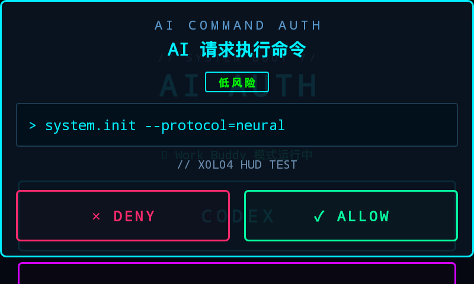

# LX04 AI Command Auth · 小爱音箱 AI 授权终端

把一台小米 AI 音箱（LX04）变成 AI Agent 的**物理授权按钮**：AI 要执行命令时，命令内容实时推到音箱屏幕，由你亲手点「同意 / 拒绝」，AI 才继续。

> Turn a Xiaomi LX04 smart speaker into a physical approval terminal for AI agents — command prompts pop up on the speaker screen, you tap ALLOW / DENY, and the agent waits for your decision.



## 为什么做这个

AI Agent 自动执行 shell 命令时，最大的风险不是模型不够聪明，而是**你根本不知道它要干什么**。终端里刷屏的日志很容易被忽略，而这个项目把「授权」搬到一台你随手就能摸到的音箱上：

- 命令**全文**显示在屏幕上，不是截断的一行日志
- 风险等级（低/中/高）用颜色区分
- 有语音播报提醒（"皇上，请审批今天的奏折"）
- 点完按钮 AI 才会继续，物理隔离感更强

## 功能特性

| 功能 | 说明 |
|---|---|
| **科幻 HUD 授权弹窗** | 霓虹描边面板、终端风格命令显示、DENY/ALLOW 按钮，适配 800×480 小屏 |
| **语音播报** | 通过小爱固件自带的 `IMicoDeviceServiceInterface` 调用 TTS，弹窗/同意/拒绝各有台词 |
| **Codex 额度悬浮条** | 屏幕顶部常驻一行 Codex 剩余额度（短期/每周），数据来自 PC 端只读解析 |
| **双模式** | `CODEX` / `WORK BUDDY` 两种模式键，可扩展成任意 Agent |
| **Web 授权页** | 浏览器打开同款科幻 HUD 界面，电脑上也能审批 |
| **跨进程 HTTP API** | 任何语言 / 任何 Agent 都能接入，附 Python 客户端 |
| **开机自启** | `BootReceiver` 开机拉起服务，不用每次手动开 |
| **地址可配置** | App 内点 `SERVER` 行即可改电脑 IP，或编译期用 Gradle 属性注入 |

## 架构

```
[PC: AI Agent / WorkBuddy / Codex]
        │  POST /api/add          ① 提交待授权命令
        ▼
[PC: web_auth_server.py :8080]  ←— 授权状态（内存）
        ▲                         │
        │ ② 每 2s 轮询 /api/pending│ ② 每 2s 轮询 /api/pending
        │                         ▼
        │          [LX04 音箱 App com.lx04.codexauth]
        │             · OverlayService 前台服务 + 悬浮窗
        │             · 语音播报 / 额度悬浮条
        └── POST /api/auth ③ ←—— 用户点 DENY / ALLOW
```

- 两端只通过 HTTP 与服务器通信，无直连
- 音箱端和 Web 端是两个平行的审批 UI，共用同一套 API
- 状态保存在服务器内存里，重启清零

## 环境要求

| 项 | 要求 |
|---|---|
| 音箱 | 小米 AI 音箱 **LX04**（Android 8.1 / API 27），需能 `adb` 连接 |
| PC | Windows / macOS / Linux，Python 3.8+（服务器零第三方依赖） |
| 编译 | JDK **21**（17 亦可）+ Android SDK（compileSdk 34）+ Gradle 8.x |
| 网络 | 同一局域网，PC 与音箱互通 |

> ⚠️ JDK 25 无法编译（Gradle 8.12 不兼容），请用 JDK 17/21。

## 快速开始

### 1. 启动 PC 端授权服务

```bash
python web_auth_server.py
# 控制台会打印本机 IP，例如 http://192.168.1.10:8080
# 浏览器打开该地址可看到 Web 授权页（科幻 HUD）
```

可选：启动 Codex 额度服务（音箱顶部额度条需要）

```bash
python codex_quota_server.py     # 监听 8081，只读解析 ~/.codex/sessions，不外传会话内容
```

### 2. 编译 App

```bash
cd codex_app
JAVA_HOME=/path/to/jdk-21 gradle assembleDebug \
  -PauthServerUrl=http://192.168.1.10:8080 \
  -PquotaServerUrl=http://192.168.1.10:8081
```

不传参数则使用默认占位地址 `http://192.168.1.100:8080`，安装后也能在 App 内修改。

### 3. 安装到音箱

```bash
adb connect <音箱IP>:5555
adb -s <音箱IP>:5555 install -r codex_app/app/build/outputs/apk/debug/app-debug.apk
adb -s <音箱IP>:5555 shell am start -n com.lx04.codexauth/.MainActivity
```

首次打开需要点「GRANT OVERLAY」授予悬浮窗权限。

### 4. 配置并启动

- 点 App 里的 `SERVER: http://... ✎` 一行，填入 PC 地址（授权 8080 / 额度 8081），保存后自动重启服务
- 点 `CODEX` 或 `WORK BUDDY` 启动前台服务
- 状态显示「模式运行中」即已开始监听

### 5. 测试整条链路

```bash
python test_workbuddy.py
# 音箱应弹出授权窗并语音播报，点 ALLOW 后脚本输出「已授权」
```

## 接入你的 AI

```python
from lx04_auth_client import request_authorization

if request_authorization("rm -rf /tmp/build", "清理构建产物", risk_level="medium", timeout=60):
    run_command()
else:
    abort()
```

Agent 与服务器不在同一台机器时，指定地址：

```bash
export LX04_AUTH_SERVER=http://192.168.1.10:8080
```

### HTTP API

| 方法 | 路径 | 说明 |
|---|---|---|
| `GET` | `/` | Web 授权页面 |
| `GET` | `/api/pending` | 待授权命令列表 |
| `GET` | `/api/history` | 最近 50 条处理记录 |
| `GET` | `/api/check/<id>` | 单条状态：`pending` / `authorized` / `denied` |
| `POST` | `/api/add` | 提交命令 `{"command","description","risk_level"}` → `{"id"}` |
| `POST` | `/api/auth` | 回传决定 `{"id","authorized":true}` |

## 项目结构

```
lx04_auth/
├── web_auth_server.py          # 授权服务器 + 内嵌 Web HUD 页面
├── lx04_auth_client.py         # Agent 侧 Python 客户端（推荐入口）
├── codex_quota_server.py       # Codex 额度服务（:8081，只读）
├── test_workbuddy.py           # 端到端测试
├── codex_app/                  # Android 工程
│   └── app/src/main/java/com/lx04/codexauth/
│       ├── MainActivity.java       # 模式选择 / 权限 / 服务器地址设置
│       ├── OverlayService.java     # 轮询 + 悬浮窗 + 语音 + 额度条
│       ├── XiaoAiSpeech.java       # 小爱固件 TTS（Binder 调用）
│       ├── CodexQuota.java         # 额度读取
│       ├── Config.java             # 服务器地址运行时配置
│       └── BootReceiver.java       # 开机自启
├── docs/screenshots/
├── docs/legacy/                # 早期版本文档（pc_auth_server 时代，仅参考）
└── HANDOFF.md                  # 内部开发记录（已在 .gitignore 中排除）
```

`app/`（`com.lx04.authcompanion`）是早期原型，已被 `.gitignore` 排除。
`test_auth.py` / `test_codex.py` / `test_web.py` / `pc_auth_server.py` 为历史版本，保留仅供追溯。

> 仓库未包含 Gradle wrapper 与 Gradle 分发包（体积原因）。用 Android Studio 直接打开 `codex_app/` 即可，或本地安装 Gradle 8.x 后执行 `gradle assembleDebug`。


## 安全说明（重要）

- **无鉴权**：`/api/add` 与 `/api/auth` 没有 token，局域网内任何设备都能调用。**只在你信任的网段使用**，切勿把 8080/8081 暴露到公网。
- **明文 HTTP**：App 启用了 `usesCleartextTraffic`，同网段可抓包看到命令内容。
- **语音接口是逆向实现**：`XiaoAiSpeech` 依赖 LX04 固件导出的 `IMicoDeviceServiceInterface`（`ubusRelay` transaction 12），固件升级后可能失效；失效只丢语音，不影响授权。
- 额度服务只读取本机 Codex 会话中的额度字段，不上传会话内容、不接触凭据。

## 已知限制

- 弹窗串行处理：多条待授权命令一次只弹一条
- 无人点击时弹窗会一直挂着（无自动超时）
- 服务器状态在内存，重启丢失历史
- 仅在 LX04 上验证，其他小爱型号的语音接口未适配

## Roadmap

- [ ] API token / 白名单鉴权
- [ ] 弹窗超时自动拒绝 + 上报
- [ ] 状态持久化（SQLite）
- [ ] 高风险命令二次确认
- [ ] 多台音箱 / 多 Agent 分流

## License

[MIT](LICENSE)
